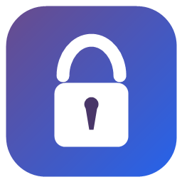
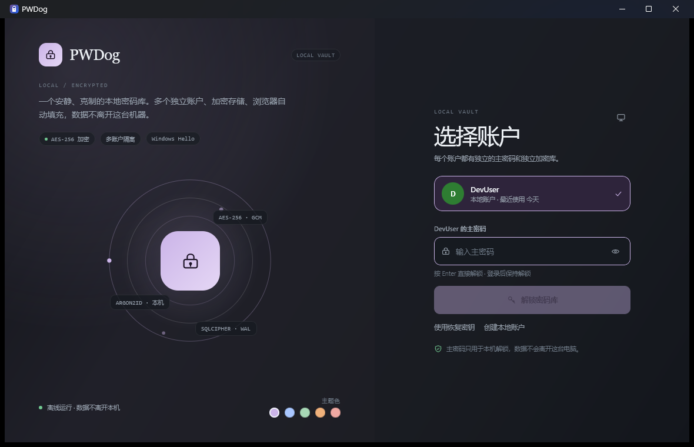
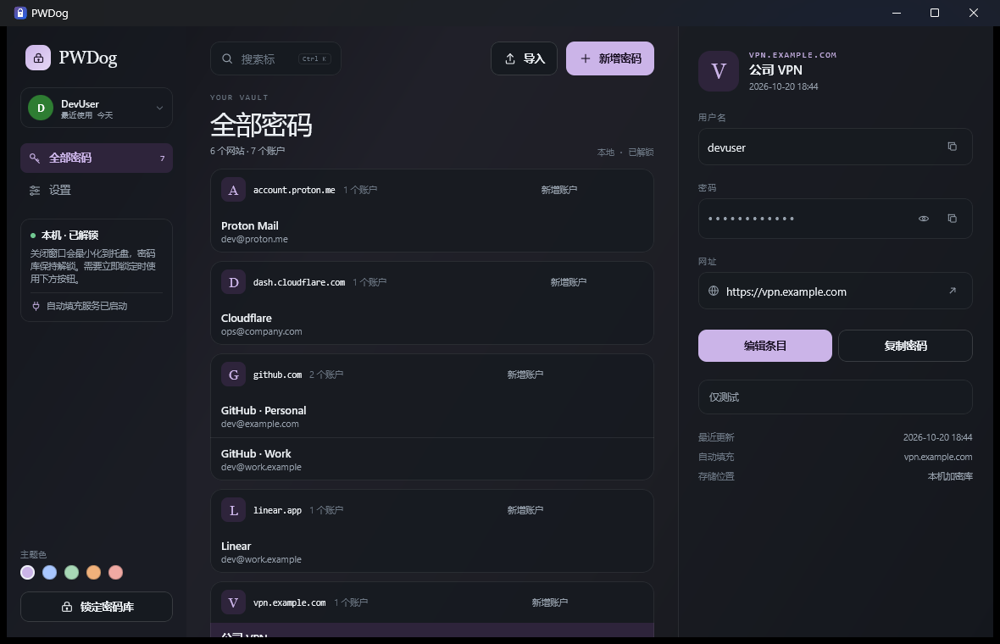
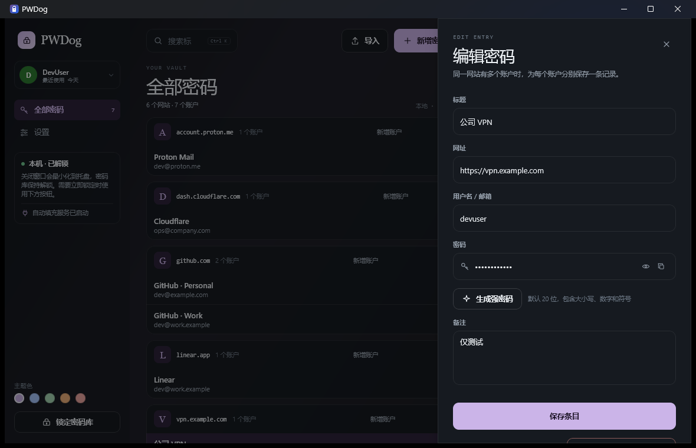
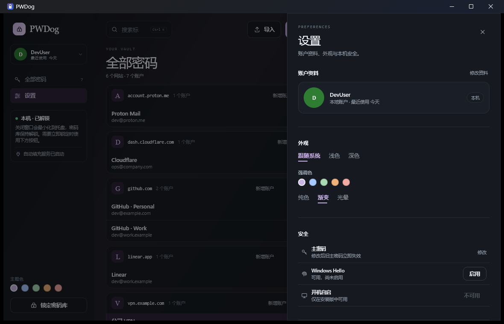

<p align="center">
  
</p>

<h1 align="center">PWDog</h1>

<p align="center">
  安静、克制的本地密码库。<br>
  Windows 优先 · 多账户隔离 · 无服务器 · 数据只留在这台电脑
</p>

<p align="center">
  <a href="https://github.com/carpentist/PWDog/releases/latest"></a>
  
  
  
</p>

---

PWDog 是一个本地优先的 Windows 密码管理器。它把账户和密码保存在 SQLCipher 加密的本地数据库里，不依赖任何服务器、云同步或在线账户。程序内可以建立多个相互独立的本地账户，每个账户拥有自己的主密码、恢复密钥和加密库。

界面采用柔和深色、细线与衬线标题的 Quiet Vault 风格；登录后保持解锁，关闭窗口只会最小化到托盘。

## 功能

- **本地加密存储**：SQLCipher v4 兼容的加密 SQLite，WAL 模式，原子写入。
- **多账户隔离**：每个本地账户使用独立的主密码和独立数据库文件，互不可见。
- **同站多账户**：同一网站下的多个登录条目自动归组，例如个人与工作账号。
- **现代密钥体系**：Argon2id 派生密码密钥，随机 DEK 加密密码库，AES-256-GCM 包装密钥。
- **恢复密钥**：创建账户时展示一次；忘记主密码时可重置，不必重建密码库。
- **Windows Hello 快速解锁**：由 DPAPI 保护，并绑定当前 Windows 用户。
- **浏览器自动填充**：Chrome / Edge MV3 扩展，按需获取匹配条目，不自动提交表单。
- **浏览器 CSV 导入**：识别 Chrome / Edge、Firefox、Bitwarden 与通用 CSV，导入前预览并去重。
- **外观**：深色 / 浅色 / 跟随系统，五种强调色，纯色 / 渐变 / 光晕背景，头像上传。
- **桌面细节**：托盘常驻、开机自启、Ctrl+K 搜索、Ctrl+L 锁定、15 秒后清除剪贴板。
- **无空闲锁定**：登录后保持解锁；需要离开时可手动锁定。

## 截图

| 登录 | 密码库 |
| --- | --- |
|  |  |

| 编辑条目 | 设置 |
| --- | --- |
|  |  |

## 下载与安装

从 [Releases](https://github.com/carpentist/PWDog/releases/latest) 下载最新的 `PWDog-0.2.1.msi`。

- 要求：Windows 10 / 11 x64。
- 按当前 Windows 用户安装，默认路径 `%LOCALAPPDATA%\PWDog`，不需要管理员权限。
- 当前构建未做代码签名，Windows SmartScreen 可能提示“未知发布者”；请确认文件来自本仓库的 Release，并核对 `SHA256SUMS.txt`。
- **卸载会删除当前 Windows 用户下的全部 PWDog 数据**，包括所有本地账户和密码库。卸载前请先备份。
- 升级安装不会删除数据；只有明确卸载时才会清理。

## 使用

1. 首次启动时创建本地账户，并输入至少 8 位的主密码。
2. 妥善保存只显示一次的恢复密钥。主密码与恢复密钥同时丢失时，数据无法恢复。
3. 点击“新增密码”保存登录信息；同一网站可以保存多条账户记录。
4. 在设置中启用 Windows Hello、开机自启，或调整主题。
5. 在设置 → 浏览器自动填充中查看本地接口地址和配对令牌。

### 浏览器扩展

安装版已经内置扩展文件，不需要源码：

1. 打开 PWDog 设置 → 浏览器自动填充。
2. 点击“打开扩展文件夹”。应用会把扩展解压到 `%LOCALAPPDATA%\PWDogData\extension` 并在资源管理器中打开。
3. 在 Chrome / Edge 扩展管理页启用“开发者模式”，选择“加载已解压的扩展程序”，然后选中这个文件夹。
4. 复制下面显示的接口地址与配对令牌，填入扩展设置。

桌面端锁定时不会返回密码，扩展也不会自动提交表单。

从源码运行时也可以直接加载仓库的 [`extension/`](extension) 目录；Release 同时提供 `PWDog-Extension-0.2.1.zip`。

## 安全模型

```
主密码 ──Argon2id──▶ KEK ──AES-256-GCM──▶ 随机 DEK
恢复密钥 ──────────────────AES-256-GCM──▶ 随机 DEK
                                            │
                                            ▼
                                   SQLCipher 加密密码库
```

- **KDF**：Argon2id，默认 64 MiB 内存、3 次迭代、4 并行度、16 字节盐。
- **密钥包装**：随机 256 位 DEK 由主密码 KEK 和恢复密钥分别包装；修改主密码只重新包装 DEK。
- **完整性**：每个账户使用 HMAC-SHA256 验证密钥正确性，密钥槽使用账户 ID 作为 AAD。
- **数据库**：SQLCipher v4 兼容加密 SQLite，WAL 模式；每个本地账户一个独立数据库文件。
- **Windows Hello**：快速解锁数据由 DPAPI 保护，仅当前 Windows 用户可解；主密码始终可以作为后备。
- **本地接口**：仅监听 `127.0.0.1:27831`，使用随机 Bearer 令牌，严格校验 Host / Origin；锁定后拒绝返回密码。
- **剪贴板**：复制密码后 15 秒自动清除，且只在剪贴板内容仍为原密码时清除。
- **明文边界**：`accounts.db` 中的账户名称、头像、KDF 参数和盐是明文元数据；密码、用户名和备注都在加密库内。

### 已知限制

- 这是个人项目，**尚未经过独立安全审计**。请先评估风险，不要直接用于高价值生产密钥。
- JVM 无法保证密钥在内存中的彻底擦除；进程内存转储仍可能暴露运行中的密钥。
- 程序内账户隔离不等于 Windows 用户隔离：同一 Windows 用户可以看到元数据，并尝试猜测其他本地账户的主密码。
- 浏览器扩展以开发者模式加载，未上架扩展商店。
- 当前仅支持 Windows；Android 客户端在规划中。
- 安装包未签名，暂无自动更新。

## 数据位置与备份

数据目录：

```text
%LOCALAPPDATA%\PWDogData\
├── accounts.db          # 本地账户元数据与密钥槽
├── vaults\<id>.db       # 每个账户的加密密码库
├── extension-token.txt  # 浏览器扩展配对令牌
└── settings.json        # 主题与背景设置
```

备份：**先完全退出 PWDog**（托盘 → Exit），再复制整个 `PWDogData` 目录。运行中复制可能得到不完整的 WAL 状态。

恢复：退出 PWDog，用备份目录替换原 `PWDogData`，再启动。

## 从源码构建

需要 JDK 21 与 Windows。项目附带 Gradle Wrapper，不需要单独安装 Gradle。

```powershell
# 运行测试
.\gradlew.bat :shared:jvmTest :desktopApp:test

# 直接运行桌面端
.\gradlew.bat :desktopApp:run

# 构建带卸载清理的 MSI
.\gradlew.bat :desktopApp:packageMsiWithCleanup
```

MSI 输出：`desktopApp\build\compose\binaries\main\msi\PWDog-0.2.1.msi`

也可以直接用 IntelliJ IDEA 打开项目并运行 `com.pwdog.desktop.MainKt`。

### 开发数据隔离

调试时建议把数据目录指向仓库内的临时目录，避免碰到真实密码库：

```powershell
$env:PWDOG_DATA_DIR="$PWD\.devdata"
.\gradlew.bat :desktopApp:seedDev
.\gradlew.bat :desktopApp:run
```

种子账户仅用于开发，主密码为 `DevPassword123`。`.devdata/` 已被 Git 忽略。

## 项目结构

```text
shared/       加密、KDF、密钥包装、账户服务、加密数据库、条目仓库
desktopApp/   Compose Desktop 界面、本地自动填充服务、Windows 集成、MSI 打包
extension/    Chrome / Edge Manifest V3 扩展
design/       Quiet Vault 视觉参考（HTML）
scripts/      本地数据清理等辅助脚本
docs/         截图、架构与发布说明
```

更多实现说明见 [`docs/ARCHITECTURE.md`](docs/ARCHITECTURE.md)。

## 路线图

- [ ] Android 客户端（共享加密与数据模型）
- [ ] 可选的端到端加密同步
- [ ] 密码健康检查与重复密码提示
- [ ] 代码签名安装包
- [ ] 自动更新

## 贡献

欢迎提交 Issue 和 Pull Request。开始之前请阅读 [`CONTRIBUTING.md`](CONTRIBUTING.md)。

请不要在 Issue、截图或日志中粘贴真实的密码、恢复密钥或配对令牌。

## 安全披露

如果发现安全问题，请不要公开提交 Issue，按 [`SECURITY.md`](SECURITY.md) 中的方式私下报告。

## 许可证

[MIT](LICENSE) © 2026 carpentist
