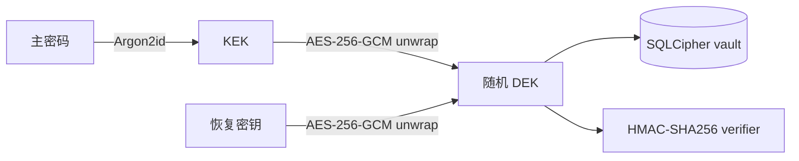
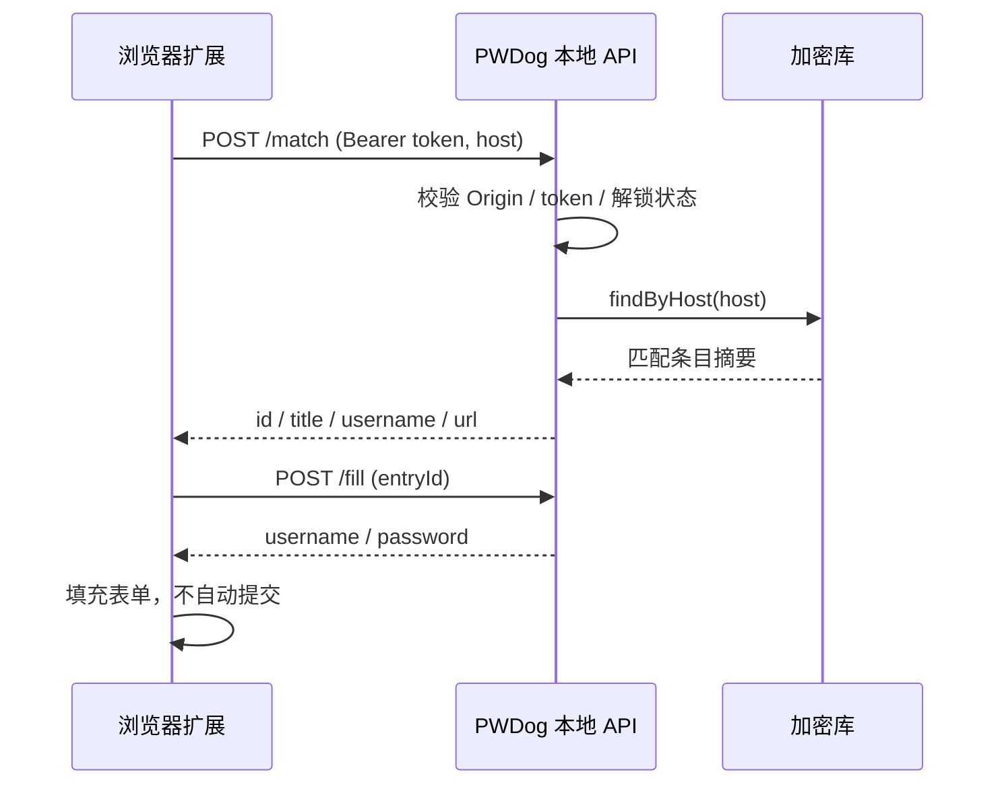

# PWDog 架构说明

本文描述当前 Windows 桌面版的实现边界。PWDog 是本地优先应用：没有后端服务，没有云同步，所有密钥材料都只在用户设备上处理。

## 模块

```text
desktopApp   Compose Desktop UI、托盘、Windows Hello、自动填充 HTTP 服务、MSI 打包
shared       纯 JVM 核心：Argon2id、密钥包装、账户注册表、加密数据库、条目仓库、CSV 导入
extension    Chrome / Edge Manifest V3 扩展
design       Quiet Vault 视觉参考，不参与构建
```

`shared` 不依赖 Compose，后续 Android 客户端可以复用其数据与加密协议。

## 密钥层级



- 创建账户时生成 32 字节随机 DEK；密码 KEK 与恢复密钥分别用 AES-256-GCM 包装 DEK。
- `accounts.db` 保存 KDF 参数、盐、包装后的 DEK、nonce、恢复密钥槽与 HMAC verifier。
- 修改主密码只重新派生 KEK 并重新包装 DEK，密码库本身不需要重加密。
- 恢复密钥是 32 字节随机值的可读分组形式；重置主密码时用恢复密钥解包 DEK。
- 所有 GCM 包装使用账户 ID 与槽类型作为 AAD，防止密钥槽被跨账户替换。

默认 KDF 参数：Argon2id，64 MiB、3 次迭代、4 并行度、16 字节盐、32 字节输出。

## 本地账户注册表

`accounts.db` 是未加密的 SQLite 注册表，保存：

- 账户 ID、显示名称、创建时间、最近使用时间
- KDF 参数与盐
- 密码槽与恢复槽（密文 + nonce）
- HMAC verifier
- DPAPI 保护的快速解锁 blob
- 头像颜色与头像 PNG

账户名称、头像和时间属于明文元数据；真正的密码库在 `vaults/<account-id>.db`，由 SQLCipher 加密，密钥为随机 DEK。

因此“程序内多账户隔离”意味着：没有对应主密码或恢复密钥就无法解密该账户的密码库；同一 Windows 用户仍能看到账户名称等元数据。

## 加密数据库

`EncryptedDatabase` 使用 `io.github.willena:sqlite-jdbc` 的 SQLCipher 兼容实现：

- 每个账户一个独立文件；
- WAL 日志模式；
- 打开时设置 256 位原始密钥，不把密钥写入 SQL 文本；
- 事务提交后写入磁盘；关闭会话时关闭连接并擦除 DEK 副本。

条目的标题、网址、用户名、密码和备注均位于加密库中。

## 浏览器自动填充



- 服务只绑定 `127.0.0.1:27831`。
- 配对令牌是 32 字节随机值的十六进制形式，保存在 `%LOCALAPPDATA%\PWDogData\extension-token.txt`。
- 扩展只能访问严格匹配当前 host 的条目；桌面端锁定时返回 `423 locked`。
- 扩展不会自动登录或提交表单，填充后仍由用户确认。

## Windows 集成

- **Windows Hello**：通过 WinRT `UserConsentVerifier` 验证用户，使用 DPAPI 保护快速解锁 payload；payload 绑定账户 ID，并在解锁时用 HMAC verifier 校验。
- **托盘**：关闭窗口只隐藏窗口，不锁定密码库；托盘菜单可显示、锁定或退出。
- **开机自启**：安装版写入 `HKCU\Software\Microsoft\Windows\CurrentVersion\Run` 的 `PWDog` 值。
- **标题栏**：DWM `DWMWA_USE_IMMERSIVE_DARK_MODE` 随主题切换。

## 打包与卸载

`desktopApp/build.gradle.kts` 中的 `packageMsiWithCleanup` 使用自定义 WiX 模板重新生成 MSI：

- 0.2.2 起按所有用户安装（提权），默认 `C:\Program Files\PWDog`，可选择 E: 等其他盘符；
- 同时发布便携版 ZIP，解压到任意目录运行，不经过 Windows Installer；
- 卸载时通过 `util:RemoveFolderEx` 删除当前 Windows 用户的 `%LOCALAPPDATA%\PWDogData`；
- 同时移除开机自启注册表值；
- `UPGRADINGPRODUCTCODE` 条件确保升级期间不会删除数据；
- 应用图标由 `desktopApp/packaging/windows/PWDog.ico` 提供。

## 测试

```text
shared/src/jvmTest    Argon2id、密钥包装、恢复密钥、账户生命周期、加密数据库、条目分组、导入、Host 匹配
desktopApp/src/test   开发种子与 DPAPI 检查工具
```

UI 使用 Compose，主要流程通过实际运行应用进行人工验证。

## 后续演进

- Android 客户端复用 `shared` 的密钥协议与条目模型；
- 引入可选同步时，保持服务端零知识，只同步密文与包装后的密钥材料；
- 代码签名与自动更新属于发布工程，不改变数据格式。
